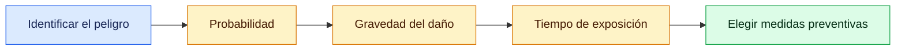
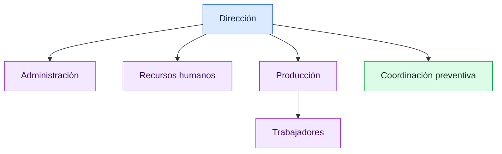

# 🦺 Repaso rápido: examen de PRL

Guía sencilla de los conceptos principales del examen. Las indicaciones sobre qué estudiar se basan en el repaso de clase; confirma siempre cualquier cambio con el profesor.

🎙️ Transcripción original del repaso

> "La grabación se ha iniciado, vale.
>
> Eh... lo dicho. Qué es la OIT, este... todo este recuadro azul, ¿vale? ¿Voy a decir cuál es la agencia europea de la seguridad...? No. A ver, esto de que dijimos en Bilbao, tal, que siempre todo me ponen Alemania o España... o España, pero nunca Bilbao. O me ponen San Petersburgo, ¿vale? Eh... no lo voy a poner. A lo mejor sí que digo cuáles son los organismos públicos de ámbito internacional, de ámbito nacional, y solo nombrarlos. Solo nombrar, ¿vale? Vale.
>
> Derechos y deberes del empresario, por supuesto, y derechos y deberes del trabajador. A lo mejor te pongo: dime cuáles son los derechos y los deberes del empresario, cuáles son los derechos y deberes del trabajador. Por supuesto.
>
> Los exámenes no serán igual en todas las clases. Tengo suficiente contenido como para hacer dos exámenes. O sea... lo mismo aquí es un modelo y en DAM es otro modelo, y allí en SMR, pues no sé, tiraré una bomba y que explote todo, ¿vale? Porque vamos, a saber... a saber lo que... a saber las barbaridades que me van a poner los documentados estos, que son más delincuentes... Pero bueno, sí, los llevaremos por el camino recto. ¿Vale? Derechos y deberes... derechos y deberes del trabajador.
>
> Tipos de sanciones, esto sí. Que hay tres tipos de sanciones: administrativa, civil y penal, ¿vale? Con su tipo de infracción. ¿Qué es la LISOS?: la Ley de Infracciones y Sanciones de Orden Social, ¿vale? Esto. Que rige que hay faltas leves, faltas graves y muy graves. Ya está. Ya si me ponéis la cuantía, ¿vale? Pero ya está. Todo... estos nueve principios no los voy a preguntar. Pensar una cosa: a mí no me gusta... no digo que no haya que hacerlo, pero a mí no me gustan las preguntas de memorizar cosas. A mí me gusta... [ininteligible].
>
> Entonces, nunca... nunca os voy a decir: dime los nueve tipos de principios de acción preventiva. A lo mejor sí que te digo: nómbrame los derechos y los deberes, pero bueno, eso a lo mejor son seis. Pero ya cuando pasan de seis, no lo voy a corregir, así que eso no lo voy a hacer, ¿vale?
>
> Las técnicas de prevención es básicamente... lo... si me sé los tipos de riesgos que hay y demás, sé lo que hay en las técnicas de prevención. A lo mejor te digo: ponme un ejemplo real de un EPI y de un EPC. ¿Un EPI qué era?... Equipo de prevención individual... equipo de protección individual y EPC, colectivo. Pues a lo mejor te digo: ponme ejemplos, ¿vale? EPI y EPC, ¿vale? [ininteligible] ...protección individual, asignación... señalización... no, esto no me gusta. Ya está. De este tema ya está, ¿vale? Bien. Ya, ¡joder! De aquí han salido varias preguntas.
>
> Se cargará. ¿Sí o no? Uy, ¿qué pasa? No va. Salud. No sé por qué no va, chicos. Bueno, pues nada, lo hacemos así, está...
>
> ¡Vale! Gestión de prevención y plan de... vale, vamos a ver. ¿Qué es el plan de prevención? Coño, si estamos en estos temas de prevención de riesgos laborales, lo lógico es que esta pregunta salga. ¿Qué es el plan de prevención? ¿Qué es el plan? Es un documento que recoge la política de la empresa... este recuadro, chicos. Es un documento vivo, adaptado a la empresa y su base legal es en la Ley 31/1995. Ya está, ¿vale?
>
> Más cositas... ¿Qué...? A lo mejor os digo: hazme un ejemplo de... de plan de prevención, y tenéis que inventaros una empresa, lo que hacéis... ¿sabes? Más modo ejemplo que "defíneme lo que es un plan de prevención". Estructura organizativa, pues así... pues la estructura organizativa la daré. Tiene que haber un jefe, un coordinator, un trabajador o varios trabajadores, el departamento de recursos humanos, el departamento económico... Aquí tengo yo... bueno, ¡ay! ¿Vale? En un organigrama. O sea, a lo mejor está aquí... eh... director... eh... departamento de administración, eh... recursos humanos, mm... equipo directivo... equipo directivo... directivo... ¿Qué más faltaría aquí? El departamento económico, de cuentas, como queráis llamarlo. Y del equipo directivo qué habría: un coordinator... ¿esto qué es? Bueno, mentira. Ahí estaría dirección... equipo directivo. Cuando hablamos de dirección, hablamos de el director de una empresa, aunque sea dirección... equipo directivo, ¿vale? Departamentos: departamento de producción, vamos a llamarlo de producción o lo que sea, ¿vale? Y luego aquí, en el departamento de producción: los trabajadores. Aquí, evidentemente, estaría eh... los trabajadores de recursos humanos, los trabajadores de tal, ¿vale? Todo esto serían trabajadores de los distintos departamentos, ¿vale? Y ya está, ¿vale? Pues a lo mejor os digo: hacedme esto. Algo rápido, no tiene que tener más, como ejemplo.
>
> Más cosas... eh... vías de comunicación a través de... pues yo qué sé. Definir lo fundamental. Política y objetivos: pues la empresa se dedica a la fontanería, a la fontanería. Organización preventiva: modalidad asignada... pues a lo mejor lo que os dije, modo online me hacen el... me dan como trabajador el curso y lo tengo que hacer modo online, o modo presencial porque viene una persona de fuera y nos hace el curso a los trabajadores. Perdón, ¿vale? Eh... auditorías propias o externas, ya está, ¿vale? Un ejemplo. Perfectos.
>
> Seguimos para... para bingo. Venga, va. ¿Qué es el riesgo? A lo mejor una frase de... o sea, una pregunta es ¿qué es el riesgo? Tipos de riesgo, ¿vale? ¿Eh? Sí, qué es el riesgo, qué sería... y ahí puedes: el riesgo es aquello que... o sea, es lo que identificamos como peligro. Toda... toda fuente posible de daño. Página 5, ¿lo tienes, Saúl? ¿Vale? Eh... estimación del riesgo, probabilidad, gravedad y exposición, y ahora qué es lo de la tablita esta de cruzamos... la siguiente. Lo de cruzamos nivel de riesgo por probabilidad, ¿vale? Pero esta... esta tablita no la voy a... no la voy a preguntar. Me interesa más esto: que sepáis lo que es el riesgo y que existe una probabilidad o una gravedad, ¿vale? Tiene un... anuncio... eh... bebida... ¡ay! Es que soy muy mayor, chicos. Había un anuncio... eh... ¿qué es el riesgo?..."

## 🔵 1. Salud, trabajo y riesgos

- **Salud:** bienestar físico, mental y social; no es solo la ausencia de enfermedad.
- **Prevención:** medidas para evitar o reducir los riesgos laborales.
- **Riesgo laboral:** posibilidad de sufrir un daño derivado del trabajo.
- **Condición de trabajo:** cualquier característica del trabajo que pueda afectar a la seguridad o la salud.
- La norma principal es la **Ley 31/1995 de Prevención de Riesgos Laborales (LPRL)**.

Los agentes de riesgo pueden ser **físicos** (ruido, iluminación), **químicos** (gases, polvo) o **biológicos** (virus, bacterias). También hay riesgos **ergonómicos** (posturas, cargas) y **psicosociales** (estrés, acoso, exceso de trabajo).

### Valorar un riesgo

## 🟢 2. Organismos y responsabilidades

| Ámbito | Organismo | Función |
|---|---|---|
| Internacional | **OIT** | Promueve los derechos y las condiciones de trabajo. |
| Internacional | **EU-OSHA** | Difunde información sobre seguridad y salud laboral en Europa. |
| Nacional | **INSST** | Investiga y asesora en prevención. |
| Nacional | **ITSS** | Vigila el cumplimiento de la normativa laboral. |

- **Empresa:** evalúa riesgos, planifica medidas, informa y forma al personal, y proporciona protección.
- **Persona trabajadora:** sigue las instrucciones, utiliza correctamente los equipos y comunica los riesgos.
- **Responsabilidad administrativa:** sanciona incumplimientos; **civil:** repara daños; **penal:** castiga conductas delictivas.
- **LISOS:** Ley sobre Infracciones y Sanciones en el Orden Social. Clasifica las infracciones como **leves, graves o muy graves**.

## 🟠 3. Protección y organización preventiva

- **EPC (protección colectiva):** protege a varias personas, por ejemplo, una barandilla o un resguardo de máquina.
- **EPI (protección individual):** protege a quien lo lleva, por ejemplo, casco, gafas o calzado de seguridad.
- Siempre que sea posible, se prioriza la protección colectiva.
- El **plan de prevención** organiza cómo integra la empresa la prevención. Es un documento vivo, adaptado a la empresa; se enmarca en la LPRL y el RD 39/1997.

### Esquema de organización

## ✅ 4. Prioridades del examen

| Repasa | No hace falta memorizar, según el repaso |
|---|---|
| Qué significa **OIT** y nombrar organismos de PRL. | La sede de la agencia europea. |
| Derechos y deberes básicos de empresa y trabajadores. | Los nueve principios preventivos de memoria. |
| Responsabilidades, LISOS e infracciones leves, graves y muy graves. | Las cuantías exactas de las multas. |
| Diferencia entre EPI y EPC y proponer ejemplos. | La tabla que combina los niveles de riesgo. |
| Explicar el plan de prevención y hacer un organigrama sencillo. | — |
| Explicar un riesgo usando probabilidad, gravedad y exposición. | — |

> 🟡 Puede haber distintos modelos de examen. Prioriza comprender los conceptos y saber aplicarlos a ejemplos.

## ✍️ 5. Ejemplo práctico

**Caso:** en un taller hay agua en el suelo y una persona podría resbalar.

1. **Riesgo:** caída por resbalón.
2. **Probabilidad y exposición:** ¿con qué frecuencia se moja el suelo y cuántas personas pasan por allí?
3. **Gravedad:** ¿qué lesión podría causar la caída?
4. **Medidas:** reparar la fuga, secar el suelo y señalizar la zona mientras esté mojada.

Para una empresa de fontanería, también podrías dibujar el organigrama anterior y proponer formación sobre el uso seguro de herramientas.
