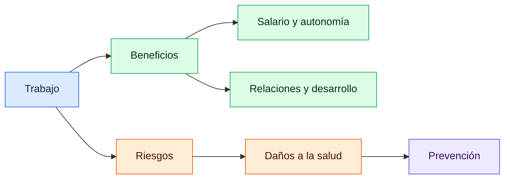
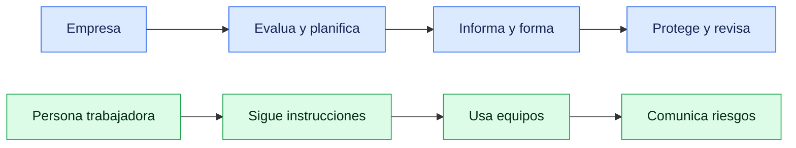
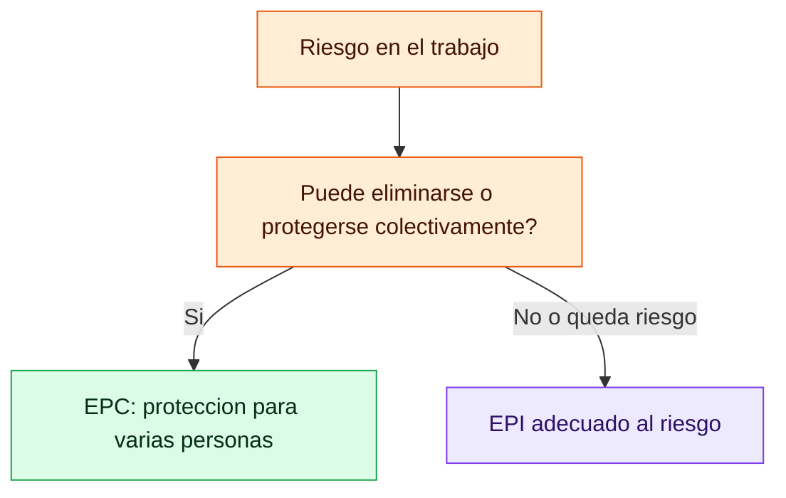
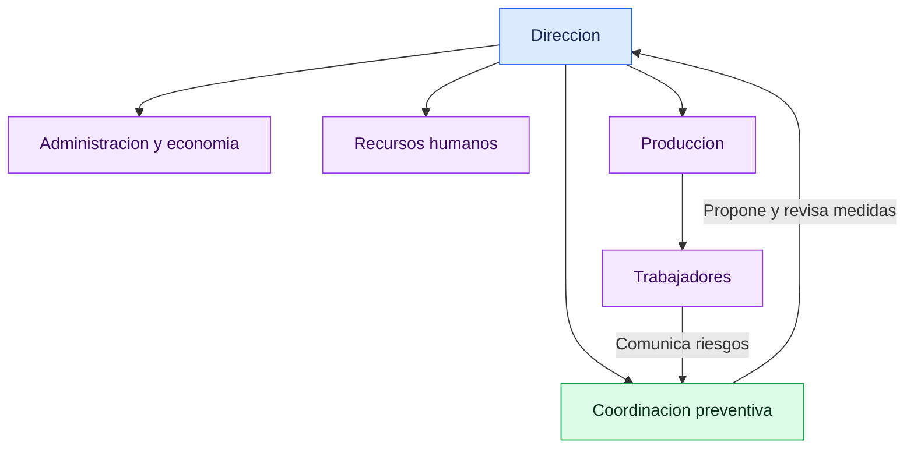
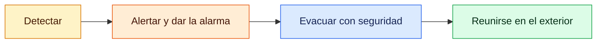
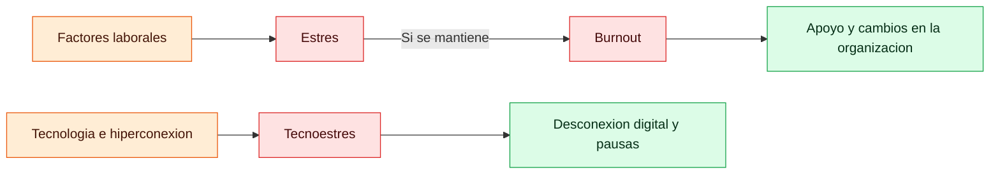

# Repaso de examen — PRL (Temas 1–5)

  
  
  

Guía de preguntas y respuestas para estudiar, contrastada con los cinco PDF teóricos. Las preguntas de los temas 2–5 reflejan el repaso del profesor; el **Tema 1 no aparece en la grabación**, así que esa sección se basa en su PDF y no se atribuye al profesor.

> 🔎 **Cómo usar esta guía:** contesta primero cada pregunta sin mirar la respuesta y después comprueba los conceptos destacados. La transcripción es automática; las preguntas se han redactado de forma legible y no siempre son citas literales.

## 🧭 Índice

- [Tema 1 — Salud y trabajo](#-tema-1--salud-y-trabajo)
- [Tema 2 — Organización de la prevención](#-tema-2--organización-de-la-prevención)
- [Tema 3 — Gestión de la prevención](#-tema-3--gestión-de-la-prevención)
- [Tema 4 — Emergencias y primeros auxilios](#-tema-4--emergencias-y-primeros-auxilios)
- [Tema 5 — Salud psicosocial](#-tema-5--salud-psicosocial)
- [Repaso final](#-repaso-final-qué-priorizar)

## 🦺 Tema 1 — Salud y trabajo

> 🔵 **Fuente: Tema 1 PDF.** El profesor empezó a grabar después de hablar de este tema; estas preguntas se basan en los apuntes, no en el audio.

### ¿Qué efectos puede tener el trabajo sobre la salud?

El trabajo puede aportar salario, autonomía económica, relaciones sociales y desarrollo personal. También puede perjudicar la salud si sus condiciones generan riesgos.

### ¿Qué es la salud según la OMS?

Es un estado de completo bienestar **físico, mental y social**, no solo la ausencia de enfermedad.

### ¿Qué significan prevención, riesgo laboral y riesgo grave e inminente?

- **Prevención:** conjunto de acciones para eliminar o reducir los riesgos laborales.
- **Riesgo laboral:** posibilidad de que una persona trabajadora sufra un daño derivado del trabajo; se considera la posibilidad y la gravedad del daño.
- **Riesgo grave e inminente:** puede ocurrir pronto y causar un daño serio a la salud.
- **Condición de trabajo:** característica del trabajo que puede influir de forma importante en los riesgos.

### ¿Qué agentes pueden causar riesgos? Da ejemplos.

| Agente | Ejemplos | Posibles daños |
|---|---|---|
| **Físico** | Ruido, vibraciones, iluminación, temperaturas y radiaciones. | Pérdida auditiva, fatiga u otros daños físicos. |
| **Químico** | Polvo, gases, vapores y sustancias tóxicas. | Irritación, intoxicación o enfermedad. |
| **Biológico** | Virus, bacterias, hongos y protozoos. | Infecciones, alergias o toxicidad. |

También se estudian riesgos **ergonómicos**, como esfuerzos o manipulación de cargas, y **psicosociales**, relacionados con la organización y el entorno de trabajo.

> 🟢 **Idea clave:** identifica el agente, piensa qué daño puede causar y relaciona ese riesgo con una medida preventiva.

### ¿Cómo se clasifican los agentes biológicos?

1. **Grupo 1:** es poco probable que cause enfermedad.
2. **Grupo 2:** puede causar enfermedad, con bajo riesgo de propagación; suele haber tratamiento.
3. **Grupo 3:** puede causar enfermedad grave y propagarse; suele haber tratamiento.
4. **Grupo 4:** puede causar enfermedad grave, propagarse y no suele haber tratamiento eficaz.

### ¿Qué medidas ayudan al levantar una carga?

Acercar la carga al cuerpo, apoyar bien los pies, doblar las rodillas, mantener la espalda recta y no girar el tronco mientras se sujeta. Si la carga es pesada o voluminosa, pedir ayuda. La manipulación manual de cargas se regula en el **RD 487/1997**.

## 🌍 Tema 2 — Organización de la prevención

### ¿Qué es la OIT y qué organismos públicos de PRL hay?

La **OIT** (Organización Internacional del Trabajo) es una entidad de la ONU que promueve la seguridad, la salud y mejores condiciones laborales. Su estructura es tripartita: participan gobiernos, empleadores y trabajadores.

Otros organismos que puedes nombrar:

- **EU-OSHA:** Agencia Europea para la Seguridad y la Salud en el Trabajo; difunde investigaciones, buenas prácticas e información sobre riesgos.
- **INSST:** organismo técnico nacional que asesora, investiga y forma en prevención.
- **ITSS:** inspecciona el cumplimiento de la normativa; puede sancionar o paralizar una actividad ante un riesgo grave.
- **Comisión Nacional de Seguridad y Salud en el Trabajo:** órgano asesor y de diálogo entre Administraciones, organizaciones empresariales y sindicatos.

> 🟢 **Prioridad del profesor:** saber qué es la OIT y nombrar organismos por ámbito. Dijo que no preguntaría la sede de EU-OSHA.

### ¿Qué deberes tiene la empresa y qué derechos y obligaciones tiene la persona trabajadora?

**La empresa debe:** garantizar la seguridad y la salud; integrar la prevención; disponer del plan, evaluar los riesgos y planificar medidas; informar y formar; proporcionar gratuitamente los EPI necesarios; proteger especialmente a personas vulnerables; y asumir el coste de las medidas.

**La persona trabajadora tiene derecho a:** recibir información y formación; disponer de EPI adecuados sin coste; participar en la prevención; y acceder a vigilancia de la salud conforme a los riesgos. Ante riesgo grave e inminente puede interrumpir la actividad y ponerse a salvo según el procedimiento.

**También debe:** cuidar de su seguridad y la de otras personas; usar equipos y EPI correctamente; no anular protecciones; informar de riesgos; y cumplir las normas preventivas.

**Vigilancia de la salud:** generalmente es voluntaria y confidencial, con las excepciones previstas legalmente. La empresa recibe la información necesaria sobre aptitud, no el historial clínico.

### ¿Qué responsabilidades y sanciones existen? ¿Qué es la LISOS?

- **Administrativa:** sanciona el incumplimiento de la normativa preventiva.
- **Civil:** busca reparar los daños, normalmente mediante compensación.
- **Penal:** puede castigar conductas delictivas o incumplimientos graves que pongan en peligro a las personas.

La **LISOS** es la Ley sobre Infracciones y Sanciones en el Orden Social. Clasifica las infracciones como **leves, graves y muy graves**.

**Prioridad del profesor:** saber los tres tipos y los grados de infracción; dijo que no hacía falta memorizar las cuantías de las multas.

| 🔴 Administrativa | 🟠 Civil | 🟣 Penal |
|---|---|---|
| Sanciona incumplimientos. | Repara el daño. | Castiga conductas delictivas. |

### ¿Qué técnicas de prevención puedo relacionar con un riesgo?

| Técnica | Ejemplo de aplicación |
|---|---|
| **Seguridad en el trabajo** | Resguardar una máquina o instalar una barandilla para evitar accidentes. |
| **Higiene industrial** | Controlar ruido, polvo, gases u otros agentes del ambiente. |
| **Ergonomía** | Adaptar el puesto, los equipos y las tareas a las personas. |
| **Psicosociología** | Revisar cargas de trabajo, pausas y factores de organización. |
| **Medicina del trabajo** | Vigilar y proteger la salud, detectando daños tempranamente. |

La formación y la información también son medidas preventivas importantes. El profesor no espera recitar de memoria los nueve principios de acción preventiva.

### ¿Cuál es la diferencia entre EPC y EPI? Pon un ejemplo de cada uno.

- **EPC (equipo de protección colectiva):** protege a varias personas a la vez. Ejemplos: barandilla, red de seguridad, resguardo de máquina o extracción localizada.
- **EPI (equipo de protección individual):** lo lleva o sujeta una persona para protegerse de riesgos concretos. Ejemplos: casco, gafas, guantes, protección auditiva, mascarilla o arnés.

Se prioriza la protección colectiva cuando sea posible. El EPI se selecciona según el riesgo, se usa siguiendo sus instrucciones y no sustituye una medida colectiva adecuada.

## 📋 Tema 3 — Gestión de la prevención

### ¿Qué es el plan de prevención?

Es el documento que recoge la política preventiva y cómo integra la empresa la prevención en su actividad. Lo aprueba la dirección, debe ser conocido por la plantilla y estar disponible para representantes y autoridades. Es un documento **vivo**, adaptado a la empresa y revisado cuando sea necesario. Su marco legal incluye la **Ley 31/1995** y el **RD 39/1997**.

### ¿Qué debe incluir el plan de prevención?

1. **Datos de la empresa:** actividad, centros de trabajo y número de personas empleadas.
2. **Proceso productivo:** tareas y actividades peligrosas.
3. **Estructura organizativa:** organigrama, responsabilidades y vías de comunicación.
4. **Política y objetivos** preventivos.
5. **Organización preventiva:** modalidad elegida, recursos y representación.
6. **Revisión:** auditorías y evaluaciones periódicas para mantenerlo al día.

### ¿Cómo sería un ejemplo sencillo de plan y organigrama?

Para una empresa de fontanería, la política puede comprometerse a identificar los riesgos de cada tarea, formar al personal en el uso seguro de herramientas y revisar incidentes. Un organigrama simple puede incluir dirección, administración/economía, recursos humanos, producción, trabajadores y coordinación preventiva. La coordinación preventiva comunica riesgos a dirección y a los equipos; los trabajadores informan de peligros a sus responsables.

La empresa puede explicar cómo organiza la formación: por ejemplo, sesión presencial con una persona técnica o curso en línea apropiado para el contenido. También puede describir cómo revisará el plan mediante evaluaciones y auditorías. **No se debe afirmar que una auditoría externa sea obligatoria para todas las empresas.**

### ¿Qué modalidades preventivas puede elegir una empresa?

Según su tamaño y actividad, los apuntes describen: asunción por el empresario si se cumplen las condiciones legales; designación de trabajadores; servicio de prevención propio; o servicio de prevención ajeno.

### ¿Qué es el riesgo y cómo se estima?

El **peligro** es una fuente o situación capaz de causar daño; el **riesgo** es la posibilidad de que el trabajo produzca ese daño y la gravedad que podría tener. Para estimarlo se consideran **probabilidad**, **gravedad** y **exposición**.

**Ejemplo:** el suelo mojado es el peligro; resbalarse y lesionarse es el riesgo. Se pregunta con qué frecuencia se moja, cuánto dura, cuántas personas pasan y qué gravedad podría tener la caída. El profesor dijo que no preguntaría la tabla que combina niveles de riesgo.

### ¿Quién evalúa los riesgos y cuándo?

La empresa organiza la evaluación con personal que tenga formación preventiva adecuada y contando con la información de quienes conocen las tareas. Se realiza al iniciar la actividad y se actualiza periódicamente o cuando cambian las condiciones, aparecen nuevas tecnologías, hay problemas de salud o se identifican personas especialmente sensibles.

### ¿Qué es la actividad preventiva?

Es el conjunto de medidas para eliminar o reducir riesgos **antes de que causen daños**. La planificación concreta cada medida, su responsable, los recursos necesarios y el plazo de ejecución.

### ¿Cuáles son los niveles de técnicos de prevención y qué hace el nivel básico?

Los niveles son **básico, intermedio y superior**, con formación y responsabilidad crecientes. El nivel básico fomenta la cooperación y los hábitos seguros, apoya tareas preventivas elementales y comunica riesgos dentro de sus competencias.

> 🟢 **Prioridad del profesor:** puede preguntar los niveles y qué hace el básico. Dijo que no preguntaría la representación ni el número de delegados.

## 🚨 Tema 4 — Emergencias y primeros auxilios

### ¿Qué diferencia hay entre el plan de prevención y el de autoprotección?

El plan de prevención organiza la integración de la prevención en la empresa. El plan de autoprotección organiza cómo prevenir y responder a emergencias en centros o actividades para los que lo exige la normativa aplicable. No hay que confundirlos: el primero es general; la necesidad del segundo depende de la actividad y la regulación aplicable.

### ¿Qué incluye el contenido mínimo del plan de autoprotección?

El PDF organiza el contenido en seis bloques: **características del edificio y su entorno; identificación y evaluación de riesgos; inventario de medios de protección; plan de actuación ante emergencias; integración con planes de ámbito superior; e implantación, mantenimiento y actualización**.

### ¿Qué hay que hacer ante una emergencia y durante una evacuación?

Secuencia resumida por el profesor: **detectar el riesgo, dar la alerta o alarma, evacuar y reunirse fuera**. Durante la evacuación, seguir las instrucciones y rutas indicadas, no bloquear las salidas y dirigirse al punto de encuentro.

### ¿Qué son los primeros auxilios y qué significa PAS?

Los primeros auxilios son la atención inicial en el lugar del accidente antes de que llegue la ayuda profesional. **PAS** significa:

1. **Proteger:** evitar nuevos peligros para la víctima y para quien ayuda.
2. **Avisar:** llamar al **112** y comunicar ubicación y situación.
3. **Socorrer:** ayudar dentro de la propia formación y siguiendo las indicaciones recibidas.

| 🛡️ PROTEGER | 📞 AVISAR | 🤝 SOCORRER |
|---|---|---|
| Evitar nuevos peligros. | Llamar al 112 y explicar la situación. | Ayudar dentro de la propia formación. |

### ¿Qué significa VOS?

**Ver, Oír y Sentir:** observar si el pecho se mueve, escuchar si entra y sale aire y sentir el aire en la mejilla. Es la comprobación inicial de la respiración descrita en los apuntes.

### ¿Qué es el triaje?

Es la clasificación de víctimas para ordenar la prioridad de atención según la gravedad. El profesor señaló repasar la relación entre **gravedad y color**.

### ¿Qué otras técnicas de primeros auxilios hay que repasar?

El profesor nombró **RCP, posición lateral de seguridad (PLS), quemaduras, atragantamientos y maniobra de Heimlich, fracturas, hemorragias, transporte de accidentados y botiquín de empresa**. También destacó saber qué son los primeros auxilios y repasar cómo se realizan las técnicas básicas. Para los procedimientos concretos, sigue el material y la formación impartida.

## 🧠 Tema 5 — Salud psicosocial

### ¿Qué puede generar riesgos psicosociales?

Factores de la organización y del entorno laboral: exceso de trabajo, presión de tiempo, carga mental elevada, falta de pausas o apoyo, poco reconocimiento, conflictos, acoso e hiperconexión. Pueden afectar al bienestar mental, emocional y social.

### ¿Cuáles son causas y señales del estrés?

Las causas pueden incluir demasiadas tareas, plazos continuos, poco control, falta de descanso o problemas en las relaciones laborales. Algunas señales son cansancio, dificultad para concentrarse o dormir, irritabilidad, tensión y sensación de no poder afrontar las demandas. Si persiste o empeora, conviene pedir apoyo.

### ¿Qué es el burnout y cuáles son sus señales de alarma?

El **burnout** es agotamiento asociado al estrés laboral crónico que no se ha gestionado. Puede manifestarse como cansancio persistente, distanciamiento o desmotivación respecto al trabajo y sensación de menor eficacia, además de problemas de concentración, errores o ganas de abandonar. No es simplemente estar cansado un día.

### ¿Qué es el tecnoestrés y cómo cuidarse?

El **tecnoestrés** es el malestar relacionado con el uso de tecnologías. Puede presentarse como ansiedad ante la tecnología o sobrecarga por notificaciones, hiperconexión y exigencia de estar siempre disponible.

Estrategias que recoge el tema: organizar y priorizar tareas, hacer pausas, limitar notificaciones, separar el tiempo de trabajo y descanso, evitar revisar mensajes laborales durante el tiempo libre y mantener hábitos de descanso y actividades sin pantalla. La empresa también debe evaluar y reducir los riesgos psicosociales; el autocuidado no reemplaza esa obligación.

> 🟢 **Prioridad del profesor:** qué genera los riesgos psicosociales; causas y señales del estrés; qué es el burnout y sus señales de alarma; tecnoestrés; estrategias para cuidarse y desconexión digital.

## 🎯 Repaso final: qué priorizar

| Tema | 🟢 Prioridades |
|---|---|
| **1 · Salud y trabajo** | Conceptos básicos, salud, riesgos y agentes. Basado en el PDF, no en el vídeo. |
| **2 · Organización** | OIT y organismos, derechos y deberes, responsabilidades, LISOS, técnicas, ejemplos de EPI/EPC. |
| **3 · Gestión** | Plan de prevención con ejemplo, riesgo y evaluación, actividad preventiva y niveles de técnicos. |
| **4 · Emergencias** | Diferencia entre planes, contenido mínimo, alarma/evacuación, PAS, VOS, triaje y primeros auxilios. |
| **5 · Salud psicosocial** | Factores de riesgo, estrés, burnout, tecnoestrés y desconexión digital. |

> 🟠 **No memorizar como listas:** los nueve principios preventivos, las cuantías de multas, la tabla de niveles de riesgo ni el número de delegados. El profesor dijo que no preguntaría esos detalles.
>
> 🔵 **Recuerda:** puede haber modelos de examen distintos según el grupo.

## 📚 Fuentes

- [Tema 1: Salud y trabajo](../Tema%201%20Salud%20y%20Trabajo%20PRL%20RA%201/Tema%201%20Salud%20y%20Trabajo.pdf)
- [Tema 2: Organización de la prevención](../Tema%202%20Organizacion%20PRL%20RA%201/Tema%202%20Organizacion%20PRL%20RA1.pdf)
- [Tema 3: Gestión de la prevención](../Tema%203%20Gesti%C3%B3n%20PRL%20RA%201/Tema%203%20Gesti%C3%B3n%20PRL%20RA1.pdf)
- [Tema 4: Emergencias](../Tema%204%20Emergencias%20RA%201/Tema%204%20Emergencias%20RA1.pdf)
- [Tema 5: Salud psicosocial](../Tema%205%20Salud%20psicosocial%20RA1/Tema%205%20Salud%20psicosocial%20RA6.pdf)
